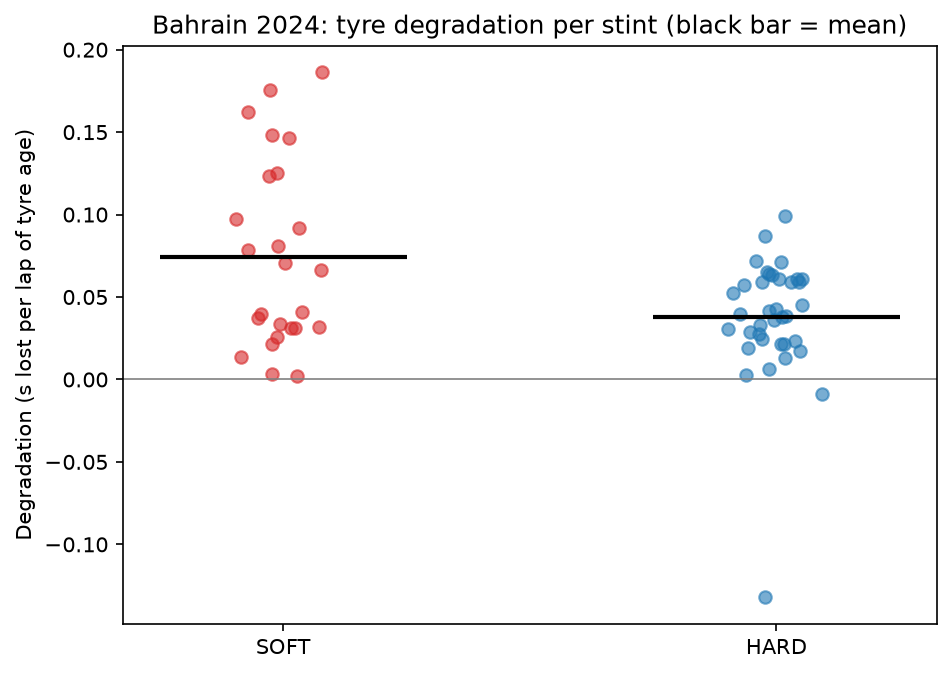
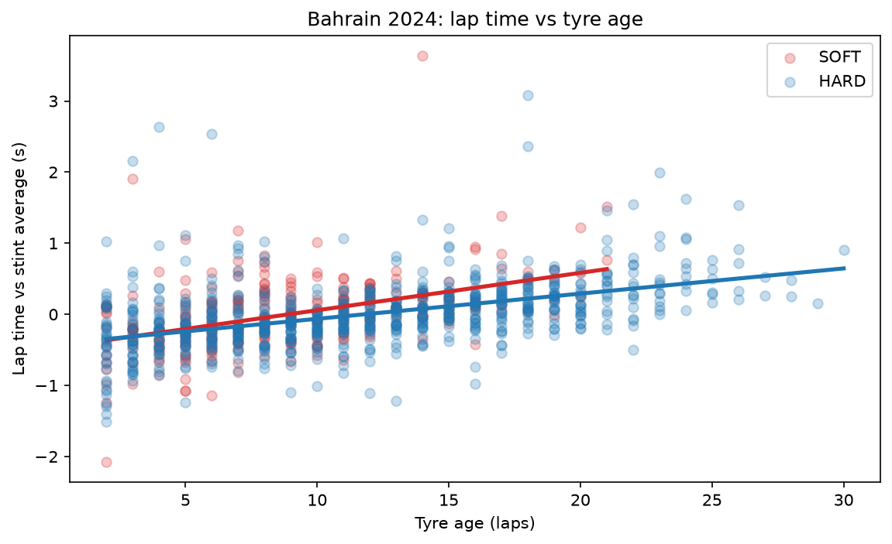

# F1 Tyre Degradation Analysis (Bahrain GP 2024)

How much lap time does an F1 car lose per lap as its tyres age, and does that differ between SOFT and HARD compounds? This project answers that with official timing data and Python.

## Data and method

- **Race:** 2024 Bahrain Grand Prix (race session)
- **Source:** [FastF1](https://github.com/theOehrly/Fast-F1), a Python library for official F1 timing data
- **Cleaning:** started from 1,129 laps and kept 1,006 clean laps by removing
  - laps with no recorded time (2)
  - pit in and out laps (84)
  - non-green-flag laps, such as yellow flags (37)
  - laps FastF1 marks as inaccurate and lap 1 (both already removed by the filters above)
  - slow outliers beyond 107% of the driver's median lap (none remained)
- **Degradation:** for each driver's stint, a straight line is fitted to lap time against tyre age. The slope is the seconds lost per lap of tyre age. A second estimate pools all stints of a compound into one fitted line, after centring each stint on its own mean lap time.
- **Fuel sensitivity:** cars get lighter as fuel burns, which makes laps faster and hides some tyre wear. Because the true effect is unknown, results are shown for three assumed fuel effects.

## Findings

SOFT tyres lost more time per lap of tyre age than HARD tyres at every fuel assumption tested.

| Assumed fuel effect | SOFT (s/lap) | HARD (s/lap) |
|---|---|---|
| none | 0.053 | 0.035 |
| 0.03 s/lap | 0.076 | 0.063 |
| 0.05 s/lap | 0.091 | 0.081 |

Averaging per-stint slopes gives 0.075 s/lap for SOFT (25 stints) and 0.038 s/lap for HARD (37 stints). The gap between compounds narrows once fuel burn is accounted for, so the direction of the result is consistent but the size of the difference is uncertain.




## Limitations

- One race only; other circuits, temperatures and seasons will differ.
- SOFT stints are short (about 8 to 13 laps), so their individual slopes are noisy, and many stints have low R-squared.
- HARD stints happen later in the race than SOFT stints, so compound and race conditions (fuel load, track state) are partly confounded.
- The fuel effect is an assumption, not a measurement.
- Traffic and driver pace management are not modelled.

## Run it yourself

```bash
python -m venv .venv
source .venv/bin/activate        # Windows: .venv\Scripts\activate
pip install -r requirements.txt
python f1_tyre_analysis.py
```

The first run downloads the race data into a local `cache/` folder. This can take a minute.
